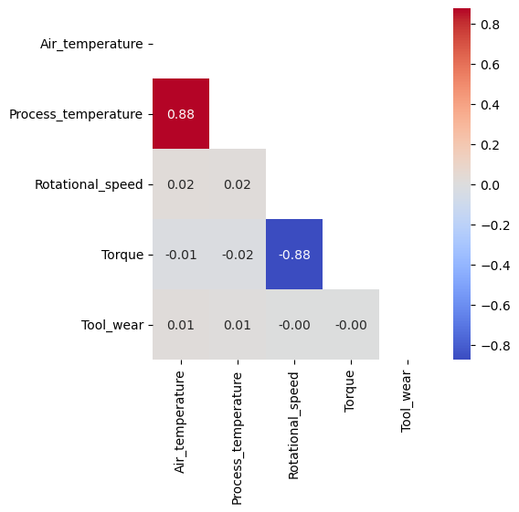

# Equipment Health Monitoring System

**An equipment-failure classification study with an interactive Streamlit interface.**

This project explores how operating measurements can be used to classify equipment failure outcomes. It includes data exploration, preprocessing, classification experiments, a saved model, and a small application for entering measurements.

## Deliverables and outcomes

- A notebook covering exploratory analysis, feature processing, class imbalance, model evaluation, and interpretation.
- A saved classifier at `model/model.pkl`.
- A Streamlit interface that accepts six inputs and returns the model's predicted label.
- Saved figures showing class distributions, correlations, and PCA exploration.

This is classification of the supplied observation. It does not establish advance warning of a future failure, a remaining-useful-life forecast, or measured reductions in factory downtime.

## Data

The project uses the **AI4I 2020 Predictive Maintenance Dataset**. UCI describes this as a **synthetic** dataset designed to reflect industrial maintenance conditions; it is not a collection of field measurements from a deployed factory system.

Source: [UCI dataset page](https://archive.ics.uci.edu/dataset/601/ai4i+2020+predictive+maintenance+dataset) · [Dataset DOI](https://doi.org/10.24432/C5HS5C)

The repository copy is `data/failures_data.csv`. Check the notebook for transformations and target-label definitions.

## Run the application

```bash
git clone https://github.com/Vijay-glitch495/Equipment-Health-Monitoring-System.git
cd Equipment-Health-Monitoring-System
python -m venv .venv
```

Activate the environment (`source .venv/bin/activate` on macOS/Linux or `.venv\Scripts\activate` on Windows), then:

```bash
python -m pip install -r requirements.txt
python -m streamlit run streamlit.py
```

Run from the repository root so the relative model and image paths resolve. The requirements pin older library versions, including scikit-learn 1.2.1 and Streamlit 1.17.0; use a compatible Python environment and preserve model/library compatibility. This documentation update did not rerun the app or retrain the model.

### Inputs

| App input | Dataset unit or meaning |
| --- | --- |
| Air temperature | Kelvin |
| Process temperature | Kelvin |
| Rotational speed | rpm |
| Torque | Nm |
| Tool wear | Minutes |
| Type | Low, Medium, or High product-quality category |

The app currently accepts inputs without enforcing physically realistic ranges. Validate units, ranges, category mappings, and label semantics before interpreting a prediction. Only load a pickle model you trust; pickle loading executes serialized Python behavior.

## Repository guide

| Path | Purpose |
| --- | --- |
| `Equipment Health Monitoring System.ipynb` | Analysis and modeling workflow |
| `streamlit.py` | Interactive prediction interface |
| `model/model.pkl` | Saved model artifact |
| `data/failures_data.csv` | Local dataset copy |
| `images/` | Analysis figures and UI assets |
| `requirements.txt` | Python dependencies |



## Evaluation and limits

Inspect the notebook's split, resampling order, per-class precision/recall/F1, and confusion matrices before quoting a score. The README does not claim an independently reproduced accuracy figure or operational benefit. A field deployment would require validation on appropriate real equipment data and its actual decision setting.

## License

Project code: [MIT](LICENSE), copyright 2024 Vijay Bommireddy. The UCI dataset has its own CC BY 4.0 terms; preserve dataset attribution.
